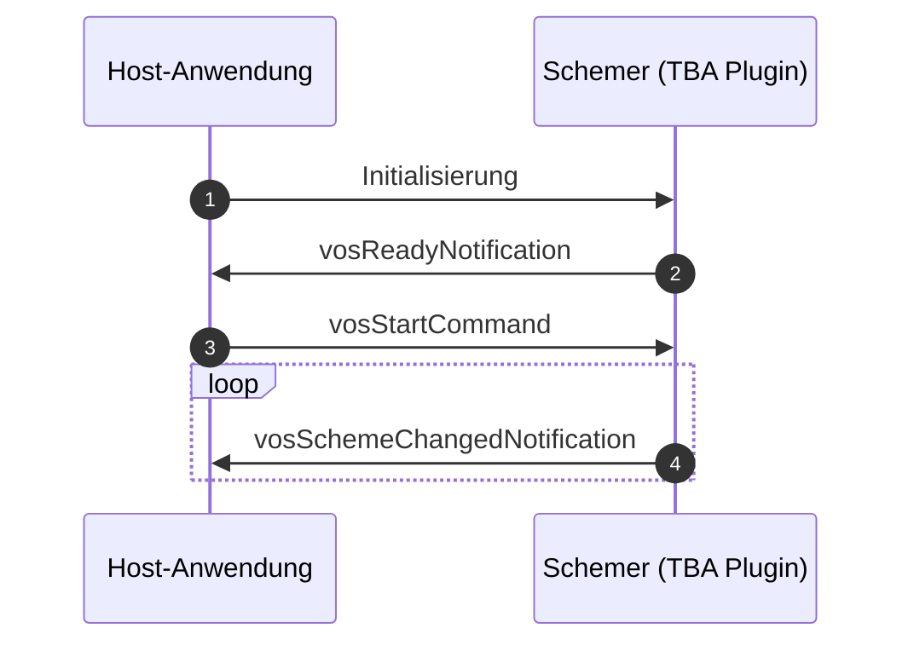

This repo is part of the tba specifications and focuses on the specification of schemer plugin.

[Docs](https://iqb-specifications.github.io/concepts/plug-ins) (German only)

## release notes

Please see the [release section](https://github.com/iqb-specifications/plugin-schemer/releases) of this repository to learn about changes.

## For Contributors

This api is written as [async api](https://www.asyncapi.com/de) yaml file. After committing to main branch, a GitHub action is triggered to build the html page. Create an release with release notes.

For a human readable version of the spec [see here](https://iqb-specifications.github.io/plugin-schemer).

# Kommunikation

::: {#spec}

# 1 Initialisierung

Der Host richtet ein `<iframe>`-Element ein und setzt für das `srcdoc`-Attribut den kompletten Inhalt des Moduls. Das Modul ist technisch eine Html-Seite, d. h. es wird durch das Laden auch die Ausführung von JavaScript-Code angestoßen, der auf oberster Ebene vorgesehen ist.

# 2 Ready Notification

Dieser Code sendet als letzten Schritt der eigenen Initialisierung eine Nachricht an den Host, dass das Modul bereit sei für das Start-Kommando. Als Payload wird das [Metadaten-Objekt](https://iqb-specifications.github.io/concepts/plugins/metadata.html) mitgeschickt -- hier allerdings als String serialisiert, um nicht bei jeder Änderung der Metadaten-Spezifikation alle Modul-API ändern zu müssen.

# 3 Start Command

## Parameter `variables`

Nachdem der Host die Bereitschaftsmeldung erhalten hat, schickt er die Variablenliste: Parameter `variables` -- so, wie der Editor diese Liste erzeugt hat. Nur auf Grundlage der Variablenliste kann ein Schemer arbeiten, denn es handelt sich bei einem Kodierschema ja um die Verarbeitung von Variablenwerten. Der Schemer initialisiert entsprechend die UI.

Zu Details des Praameters `variables` siehe [hier](https://iqb-specifications.github.io/concepts/plugins/variable-info.html).

## Weitere Parameter

* `sessionId`: Dem Schemer wird eine Kennung mitgeschickt, die der Schemer anschließend in jeder Nachricht zur Änderung des Kodierschemas verwenden soll. Damit wird die korrekte Zuordnung der Nachricht bzw. der darin enthaltenen Daten zur Unit unterstützt.
* Soweit vorhanden kann ein Kodierschema `codingScheme` geschickt werden, damit daran weitergearbeitet wird.
* `codingSchemeType`: Sollte es Varianten oder Versionen von Kodierschemata geben, kann dies hier dem Schemer mitgeteilt werden. Alternativ (oder parallel) kann natürlich diese Information als Teil der Datenstruktur des Kodierschemas übergeben werden.
* `schemerConfig`
  - `directDownloadUrl`: Sollte der Schemer während der Laufzeit Code nachladen müssen, kann aus Gründen der Datensicherheit nicht einfach irgendein Server genutzt werden. Dem Schemer muss mitgeteilt werden, welche URL dafür zulässig ist.
  - * `sharedParameters`: Daten, die zur Laufzeit zwischen Schemer-Modulen ausgetauscht werden sollen. Details siehe [hier](https://iqb-specifications.github.io/concepts/plugins/communication.html#gemeinsame-parameter-sharedparameters).

# 4 Scheme Changed Notification

Sobald eine Bearbeitung des Kodierschemas stattgefunden hat, meldet der Schemer diese Änderung. Parameter:

* `sessionId`: Die Kennung aus dem Start-Kommando, um die korrekte Zuordnung der Nachricht bzw. der darin enthaltenen Daten zur Unit zu unterstützen.
* `timeStamp`: Ein String im Standard-Format [date-time](https://tc39.es/ecma262/multipage/numbers-and-dates.html#sec-date-time-string-format). Die Nutzung dieser Information ist dem Host überlassen, soll aber vor allem die korrekte Reihenfolge vieler asynchron eintreffender Nachrichten sicherstellen.
* `codingScheme`: Das neue vollständige Kodierschema, serialisiert als String.
* `codingSchemeType`: Spezifizierung des Datenformates, wenn gewünscht.
* `derivedVariables`: Wenn bei der Erstellung des Kodierschemas neue Variablen abgeleitet wurden, sind diese hier mit ihren Quell-Variablen aufgelistet. Jede neue Variable referenziert dabei ausschließlich Basisvariablen, d. h. ein Bezug auf eine abgeleitete Variable ist nicht zulässig.
* `sharedParameters`: Daten, die zur Laufzeit zwischen Schemer-Modulen ausgetauscht werden sollen. Details siehe [hier](https://iqb-specifications.github.io/concepts/plugins/communication.html#gemeinsame-parameter-sharedparameters).

:::
